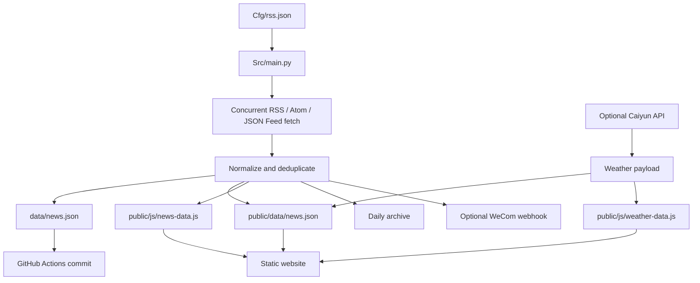

# NewsFlow Daily

<p align="center">
  <strong>一个自动化的个人信息中枢</strong><br>
  RSS 聚合 · 分类阅读 · 每日归档 · 天气卡片 · 企业微信日报
</p>

<p align="center">
  <a href="https://github.com/ilikui/Dailly/actions/workflows/main.yml"></a>
  
  
  
</p>

NewsFlow Daily 将分散在不同站点的 RSS / Atom / JSON Feed 汇集为可静态部署的新闻看板，并可按计划生成新闻快照、天气数据和企业微信日报。采集与展示分离：GitHub Actions 负责定时更新数据，前端直接读取仓库生成的 JSON / JavaScript 文件。

## Features

- **RSS aggregation** — 从 `Cfg/rss.json` 统一维护订阅源，支持 RSS 2.0、Atom 和 JSON Feed。
- **Concurrent fetching** — 并发请求多个订阅源，单个源失败不会阻断整次采集。
- **Category browsing** — 按订阅源类别展示新闻，并保留来源与原文链接。
- **Daily archive** — 将每日抓取快照写入 `data/` 和 `public/data/`，方便静态站点读取与历史回看。
- **Weather card** — 配置彩云天气 API 后生成当前天气与未来三天预报数据。
- **WeCom digest** — 可通过企业微信机器人推送 Markdown V2 格式日报。
- **Static-first frontend** — 无需运行后端服务即可部署前端，新闻数据由脚本预先生成。
- **Scheduled automation** — GitHub Actions 支持定时运行、推送触发和手动运行。

## Architecture



## Repository map

| Path | Purpose |
| --- | --- |
| `Cfg/rss.json` | RSS source catalogue; each entry contains `type`, `name`, and `url` |
| `Src/main.py` | Feed parsing, aggregation, archive generation, weather and WeCom integration |
| `public/index.html` | Main dashboard |
| `public/css/` | Dashboard styles |
| `public/js/news-data.js` | Generated current-news data |
| `public/js/news-archive-data.js` | Generated archive data |
| `public/js/weather-data.js` | Generated weather data |
| `public/data/` | Static JSON files served by the website |
| `data/` | Source data and dated snapshots |
| `.github/workflows/main.yml` | Scheduled automation and data publishing |
| `tests/` | Offline unit tests |

## Quick start

Requirements: Python 3.10 or later.

```bash
git clone https://github.com/ilikui/Dailly.git
cd Dailly
python -m venv .venv
# Windows
.venv\\Scripts\\activate
# macOS / Linux
source .venv/bin/activate
pip install -r requirements.txt
python Src/main.py
```

The script can collect RSS data without optional secrets. If a secret is absent, the related integration is skipped and a warning is printed.

Run the offline tests:

```bash
python -m pytest -q
```

## Configure RSS sources

Edit `Cfg/rss.json`. Keep the configuration as a JSON array:

```json
[
  {
    "type": "Technology",
    "name": "Example publication",
    "url": "https://example.com/feed.xml"
  }
]
```

Use a direct, publicly accessible feed URL whenever possible. A broken or slow feed is reported in the logs and does not prevent other sources from being processed.

## GitHub Actions secrets

Open **Settings → Secrets and variables → Actions** to configure optional integrations:

| Secret / variable | Required | Description |
| --- | --- | --- |
| `WEBHOOK_KEY` | No | Enterprise WeChat group bot key; enables digest delivery |
| `CAIYUN_API_KEY` | No | Caiyun Weather API token |
| `KEYWORDS` | No | Optional comma-separated keywords for digest filtering |
| `WEATHER_COORDS` | No | Optional `longitude,latitude` coordinate string; defaults to Shanghai |

The workflow runs on a schedule (Beijing time 08:00, 12:00 and 20:00), on pushes to `main`, or manually from **Actions → NewsFlow Daily → Run workflow**. GitHub scheduled jobs may start later than the requested time under platform load.

## Generated data contract

Current news records use a compact, frontend-friendly shape:

```json
{
  "title": "Example headline",
  "url": "https://example.com/article",
  "type": "Technology",
  "source": "Example publication"
}
```

The daily archive also stores `run_at`, `count`, and item summaries. Generated files are committed by the workflow so static hosting can serve them without a backend.

## Deployment

Enable GitHub Pages for the repository and select the publishing source that matches your repository configuration. If the Pages source is the `public/` directory, ensure the repository's Pages workflow/build setup publishes that directory; otherwise configure the deployment workflow to copy `public/` to the Pages artifact.

After deployment, open the published site and verify:
1. The dashboard loads without JavaScript errors.
2. News categories contain current entries and source links open correctly.
3. `public/data/news.json` and the generated JavaScript files are refreshed after a successful workflow run.
4. Weather and WeCom integrations are treated as optional when their secrets are not configured.

## Reliability notes

- Feed content is external input. Titles and URLs should be rendered safely by the frontend.
- Feed failures are expected; review Actions logs when a source repeatedly fails.
- Never commit API keys or webhook URLs. Use GitHub Actions secrets.
- This project aggregates and links to publishers' original articles; it does not republish full article text.

## License

See the repository's license file if present. RSS feeds remain the property of their respective publishers.
